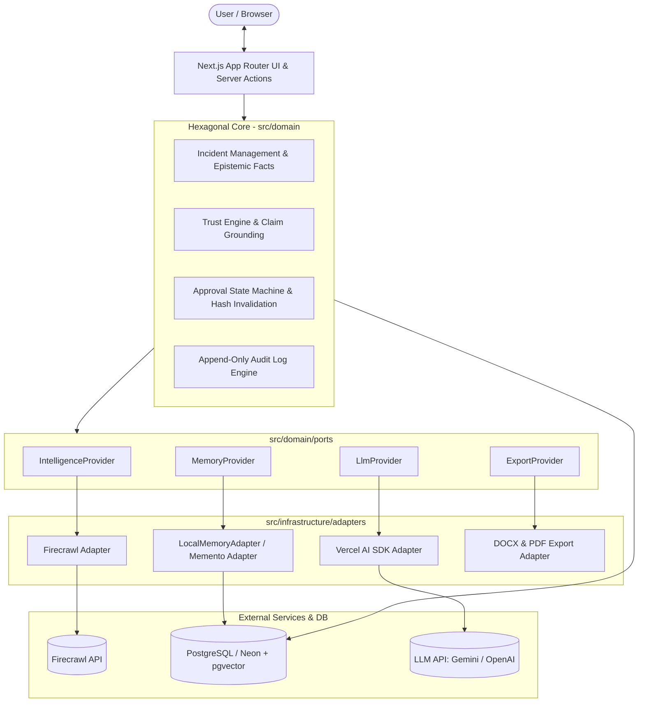

# IncidentComms AI: System Architecture

## 1. System Overview

**IncidentComms AI** is an enterprise-grade GenAI platform designed to ingest high-impact security incidents, pull verified external intelligence (via Firecrawl), retrieve approved organizational communication memory and terminology (via Memento / Local Memory Adapter), and synthesize evidence-grounded communications tailored for 5 distinct audiences:
1. **Executive Leadership** (Business risk, legal exposure, financial & operational impact)
2. **Engineering / SecOps** (IOCs, technical root cause, mitigation steps, containment procedures)
3. **All-Hands / Internal Employees** (Actionable employee guidance, phishing cautions, status updates)
4. **Customer-Facing / Public PR** (Customer impact, SLA details, transparency without premature liability)
5. **Regulatory / Compliance** (GDPR / SEC / HIPAA mandatory disclosure disclosures, timeline of discovery)



---

## 2. Ports and Adapters (Clean Architecture)

```
src/
├── domain/                      # PURE TypeScript (no framework/external imports)
│   ├── entities/               # Incident, Claim, Draft, Evidence, Approval, Audit
│   ├── epistemic/              # Epistemic status rules (confirmed, suspected, unknown, disputed)
│   ├── trust/                  # Grounding engine, quote verification, linting, quality formulas
│   ├── statemachine/           # Approval state machine & content-hash digest
│   ├── permissions/            # RBAC matrix & authorize(user, action, resource)
│   └── ports/                  # Interfaces: IntelligenceProvider, MemoryProvider, LlmProvider, ExportProvider
├── infrastructure/              # Adapters & external bindings
│   ├── adapters/
│   │   ├── firecrawl/          # Firecrawl client, allowlist filter, sanitization
│   │   ├── memory/             # LocalMemoryAdapter (PostgreSQL + pgvector) & MementoAdapter
│   │   ├── llm/                # Vercel AI SDK integration with structured outputs (Zod)
│   │   └── export/             # DOCX (docx library) and PDF generator
│   └── db/                     # Prisma client singleton, repositories, migrations
├── app/                        # Next.js App Router (UI, Server Actions, API routes)
│   ├── (auth)/                 # Login, session verification
│   ├── incidents/              # Incident intake, dashboard, details, timeline
│   ├── drafts/                 # Draft editor, claim sidebar, audience selector
│   ├── intelligence/           # Firecrawl live queries, advisory preview, quarantine
│   ├── memory/                 # Template & terminology management, vector search
│   ├── audit/                  # Tamper-evident audit trail viewer
│   └── api/                    # Auth, health check, webhook handlers
└── eval/                       # Golden incident dataset, automated evaluation scripts, ablations
```

---

## 3. Epistemic Status Model

Every field in an incident record carries a human-verified epistemic status:
- **`CONFIRMED`**: Positively verified by forensics/security lead. May be stated as definitive fact.
- **`SUSPECTED`**: Indicator observed, but attribution or scope unconfirmed. **Must use hedged language** (e.g., *"Preliminary telemetry suggests...", "Investigating potential impact to..."*). Absolute phrasing (e.g. *"Data was stolen"*) triggers deterministic validation failure.
- **`UNKNOWN`**: Fact is currently undetermined. **Must NOT be asserted**. May only be mentioned as an active area of investigation.
- **`DISPUTED`**: Conflicting evidence observed. Must explicitly state that findings are under active review.

---

## 4. Approval State Machine & Cryptographic Invalidation

Approvals are strictly dependent on the cryptographic content digest:

$$\text{DraftHash} = \text{SHA256}(\text{Audience} \parallel \text{Version} \parallel \text{BodyText} \parallel \text{ClaimsJSON})$$
$$\text{FactsHash} = \text{SHA256}(\text{IncidentSeverity} \parallel \text{EpistemicStatuses} \parallel \text{EvidenceBundle})$$
$$\text{ApprovalDigest} = \text{SHA256}(\text{DraftHash} \parallel \text{FactsHash})$$

### State Transitions:
1. `DRAFT` $\rightarrow$ `PENDING_REVIEW` (when readiness gate is `REVIEW_READY`)
2. `PENDING_REVIEW` $\rightarrow$ `APPROVED` (authorized reviewer signs with role and timestamp, storing `ApprovalDigest`)
3. `APPROVED` $\rightarrow$ `INVALIDATED` (**Automatic!** If Draft is edited or any Incident Fact changes, digest mismatch triggers revocation)
4. `APPROVED` $\rightarrow$ `PUBLISHED` / `EXPORTED` (authorized communications lead generates DOCX/PDF export)

---

## 5. Trust Engine Verification Pipeline

1. **Extraction & Grounding**: LLM generates draft text with embedded claim tags `[c1]`, `[c2]`, etc. Each claim is structured as:
   ```typescript
   interface AtomicClaim {
     id: string; // e.g. "c1"
     text: string;
     type: 'FACT' | 'INSTRUCTION' | 'ESTIMATE' | 'COMMITMENT';
     pointers: Array<{
       sourceType: 'INCIDENT_FIELD' | 'ADVISORY' | 'MEMORY_TEMPLATE';
       sourceId: string;
       quotedSpan?: string;
     }>;
   }
   ```
2. **Deterministic Layer**:
   - Verify every pointer resolves to an actual stored incident field, advisory, or template.
   - Verify all `quotedSpan` strings match verbatim within the source document.
   - Check epistemic language linter (no unhedged statements for `suspected`, no claims on `unknown`).
   - Redaction scan: Check for leaked API keys, tokens, internal IP ranges, and PII.
3. **Independent LLM Verifier Layer**:
   - LLM Verifier receives *only* the claim list and raw evidence texts.
   - Outputs: `SUPPORTED`, `UNSUPPORTED`, `CONFLICTING`.
4. **Readiness Evaluation**:
   - `BLOCKED`: Any claim is unsupported, quote missing, or required audience section absent.
   - `NEEDS_REVIEW`: Epistemic hedge alert or ambiguous wording.
   - `REVIEW_READY`: 100% citation resolution, zero ungrounded assertions, all sections present.
